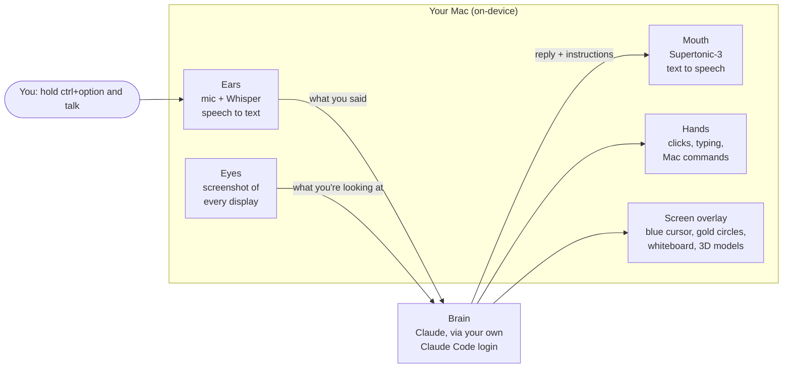
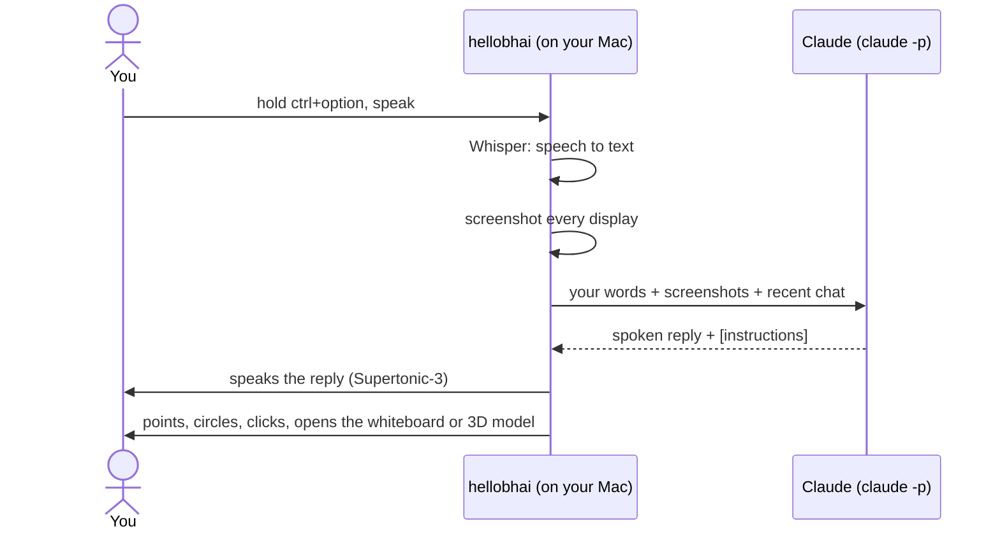

# hellobhai

A local-first AI buddy that lives next to your cursor on macOS. Hold **Control + Option**, talk in **Hindi, English or Hinglish**, and it looks at your screen, talks back, points at things, sketches live explanations, and can click and type to get things done for you.

An open-source, local-first take on [HeyClicky](https://heyclicky.com), built on top of Farza's open-source [Clicky](https://github.com/farzaa/clicky).

## Demo

**"How do these buses actually work?"** A 3D model built right over the video, then a live whiteboard of the swivel joint.


https://github.com/user-attachments/assets/f3f0f3b9-85ad-42b9-aef5-4ef3e5641740


**"What is this device?"** A Raspberry Pi hotspot, modelled part by part over the YouTube video.


https://github.com/user-attachments/assets/305cff8a-7777-4671-906f-11a68852630f


## What it does

- **Talks Hinglish.** Speak however you normally do; it auto-detects Hindi or English and replies the same way, in natural Hinglish.
- **Sees your screen.** Every question comes with a screenshot of all your displays.
- **Points at things.** A blue cursor flies over to the button or menu it's talking about.
- **Does things for you.** "Zen mein naya tab kholo", "meri latest recording Rahul ko WhatsApp pe bhejo". It mixes Mac tools (AppleScript, `open`, Spotlight, Shortcuts) with on-screen clicks and typing, checking the screen after each step. Anything that sends, posts or deletes needs your spoken "haan".
- **Explains the simple way.** Every explanation starts from something you have already lived, like a chai tapri, a dabbawala or your phone's contact list, maps the idea onto it piece by piece, and only then gives the real term.
- **Explains like a teacher at a whiteboard.** When a picture helps, an Excalidraw-style board pops up beside your cursor. Claude explains step by step out loud and draws each part as it says it: groups, boxes, hand-drawn icons, labelled arrows, numbered steps, sticky notes, and things travelling along the arrows, all laid out automatically so nothing overlaps, on an infinite canvas you can pan and zoom. Narration follows your language; the board is always in English.
- **Builds 3D models.** Ask how a machine, gadget or device works and it builds a 3D model right over it on your screen, part by part, with labels pointing at each piece. Drag to rotate.
- **Circles things.** It circles the exact text or values it's talking about on your screen, in gold. You can circle things too: hold Control + Option, drag around something and ask "what is this?".
- **Draws real math.** Exact geometry, plotted functions, shaded integrals, tangents, vectors, number lines and properly typeset equations, built up step by step as it explains.
- **Writes live notes.** "Notes bana do" or "summarize this page" and it writes notes beside your cursor as it talks: headings, highlighted key terms, syntax-highlighted code, comparison tables, sketch charts, and to-dos. Say "save kar do" to put them in Apple Notes.
- **Shows when it's talking.** A Dynamic-Island-style pill grows out of the notch while it speaks.

## How it works

### The big picture

hellobhai is a small Mac app that sits in your menu bar. It has three jobs: **listen** to you, ask **Claude** what to do, then **show and say** the answer on your screen. Everything except Claude's thinking happens on your Mac.



### What happens when you ask something

Say you're looking at a YouTube video of a gadget and you ask *"what is this device?"*

1. **You press ctrl+option.** A tiny keyboard listener notices the shortcut, even while another app is in front. The blue cursor turns into a waveform to show it's listening.
2. **You talk, then let go.** Your voice is recorded, and **Whisper** turns it into text right on your Mac. It works out by itself whether you spoke English, Hindi or Hinglish. If you circled something with the mouse while talking, that area is noted too.
3. **It takes a screenshot** of every display, so Claude can see exactly what you see.
4. **It asks Claude.** The text, the screenshots and your last few questions go to Claude through the `claude` command-line tool that comes with Claude Code. That uses your own login, so there are no API keys and no hellobhai server in between.
5. **Claude answers in two layers:** the words to say out loud, plus small instructions in square brackets for the app, like `[POINT:…]`, `[CIRCLE:…]`, `[SHOW:…]` or `[MODEL3D:…]`.
6. **The app speaks the words** with **Supertonic-3**, an on-device voice, one sentence at a time so it starts talking quickly. A small pill grows out of the notch while it speaks.
7. **The app follows the instructions:**
   - `POINT`: the blue cursor flies over to a button or menu.
   - `CIRCLE`: gold, hand-drawn circles appear around the exact text it's talking about.
   - `CLICK` / `TYPE` / `KEY`: it clicks and types for you, then takes a fresh screenshot to check. It repeats this up to 8 times until the task is done. It only does this when you ask, and it asks before sending, posting or deleting anything.
   - `SHOW` / `NOTES`: a whiteboard or a notes page opens beside your cursor (see below).
   - `MODEL3D`: a 3D model is built right on top of the thing on your screen (see below).



### How the whiteboard and 3D models work

When Claude decides a picture would help, the app asks Claude a second, focused question: *"draw this, step by step"*. Claude streams back a script, one line at a time. Each line is either a sentence to say or a drawing command, like "draw a blue box called Battery" or "add a cylinder for the antenna".

- **Narration and drawing stay in step.** Each sentence is spoken while the shapes that belong to it are drawn. The blue cursor moves along every stroke as if it were holding the pen, with a soft pencil sound.
- **The whiteboard** is a small, locked-down web page inside the app. It draws hand-drawn shapes with **rough.js**, lays out diagrams automatically with **dagre** so nothing overlaps, and renders math with **KaTeX**.
- **3D models** use **three.js**. Claude describes the object as simple parts (boxes, cylinders, repeated pins) with labels, and the app builds it part by part over the thing on your screen. You can drag to rotate it.
- **Claude never writes code that runs.** It only sends simple instructions as data. The pages can't load anything from the internet.

### The pieces, and where they live in the code

| Piece | What it uses | File |
|-------|--------------|------|
| Menu bar app and settings panel | SwiftUI + AppKit | `leanring_buddyApp.swift`, `MenuBarPanelManager.swift`, `CompanionPanelView.swift` |
| The conductor that ties it all together | | `CompanionManager.swift` |
| Push-to-talk shortcut | `CGEvent` tap | `GlobalPushToTalkShortcutMonitor.swift` |
| Ears (speech to text) | WhisperKit (Whisper large-v3 turbo) on-device, Apple Speech as fallback | `BuddyDictationManager.swift`, `WhisperTranscriptionProvider.swift` |
| Eyes (screenshots) | ScreenCaptureKit | `CompanionScreenCaptureUtility.swift` |
| Brain | `claude -p` (Claude Code CLI) | `ClaudeCLI.swift` |
| Mouth (text to speech) | Supertonic-3 (voice F2) on-device, optional Kokoro-82M, macOS voice as last fallback | `LocalTTSClient.swift` |
| Hands (clicks, typing, Mac commands) | `CGEvent`, plus an allowlist: `osascript`, `open`, `mdfind`, `shortcuts`, `ls` | `ComputerControl.swift` |
| Blue cursor, gold circles, notch pill | Transparent full-screen overlay | `OverlayWindow.swift` |
| Whiteboard and notes | WKWebView + rough.js, dagre, KaTeX, Prism | `VisualExplanationPanel.swift` |
| 3D models | WKWebView + three.js | `Model3DOverlay.swift`, `VisualToolkit/model3d.html` |

### What leaves your Mac

Only what goes to Claude: your words, the screenshots and recent chat, sent through your own Claude Code login. Listening, speaking, screenshots, drawing and 3D all run locally. There are no hellobhai servers, no analytics and no auto-updater. On first launch it downloads about 1GB of speech models from Hugging Face, once.

## Setup

### Prerequisites

- An Apple Silicon Mac on macOS 14.2+ (16GB RAM recommended; 8GB works but is tight)
- Xcode 16+
- [Claude Code](https://docs.anthropic.com/en/docs/claude-code) installed and logged in. Run `claude` once in a terminal.

### Build & run

```bash
./scripts/create-signing-cert.sh   # one time: local signing certificate
./scripts/build-and-run.sh         # build, sign, launch (run again after every change)
```

`build-and-run.sh` signs every build with the same local certificate, so macOS remembers the permissions you grant instead of asking again after each rebuild. Logs go to `build/hellobhai.log`.

### First launch

1. A triangle appears in the menu bar and the setup panel opens.
2. Grant **Microphone**, **Accessibility** and **Screen Recording**. Screen Recording needs one app restart; just run the script again.
3. Click **Start**.
4. Give it a couple of minutes: Whisper, Kokoro and Supertonic download (~1.2GB), and macOS compiles Whisper for the Neural Engine once. Until then it uses Apple's speech recognition (this needs **Dictation** turned on in System Settings → Keyboard) and the system voice.

## Using it

| Say | It will |
|-----|---------|
| "what's on my screen?" | Describe it and point at what matters |
| "UPI kaise kaam karta hai?" | Explain in Hinglish while sketching the flow live |
| "Zen mein naya tab kholo" | Do it |
| "latest recording Rahul ko WhatsApp pe bhejo" | Find the file, open the chat, attach it, and **ask before sending** |

Pressing the hotkey again interrupts whatever it's doing. Model choice (Sonnet or Opus) is in the menu bar panel.

## Project structure

```
leanring-buddy/                          # Swift source (legacy folder name)
  CompanionManager.swift                    # Central state machine + agent loop + prompts
  ClaudeCLI.swift                           # `claude -p` subprocess client (stream-json in/out)
  WhisperTranscriptionProvider.swift        # On-device STT
  LocalTTSClient.swift                      # On-device TTS (Kokoro + Supertonic-3)
  ComputerControl.swift                     # [CLICK]/[TYPE]/[KEY] parsing + CGEvents
  VisualExplanationPanel.swift              # Live sketch whiteboard
  OverlayWindow.swift                       # Purple cursor + notch speaking pill
  BuddyDictationManager.swift               # Push-to-talk pipeline
scripts/
  create-signing-cert.sh                    # One-time local signing certificate
  build-and-run.sh                          # Build, sign, relaunch
CLAUDE.md                                 # Full architecture doc (AGENTS.md links here)
```

## License

MIT, see `LICENSE`.
