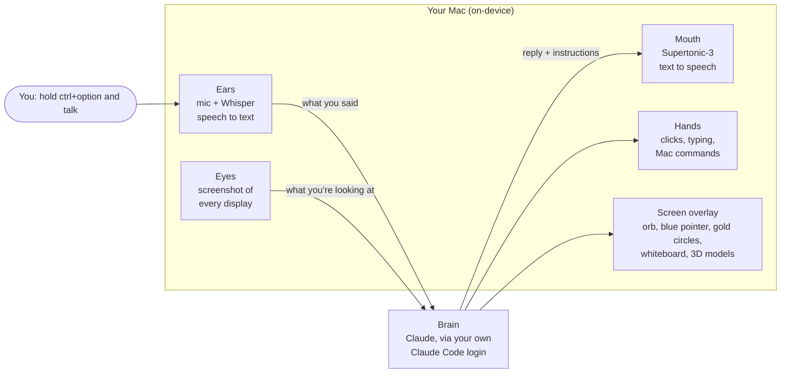
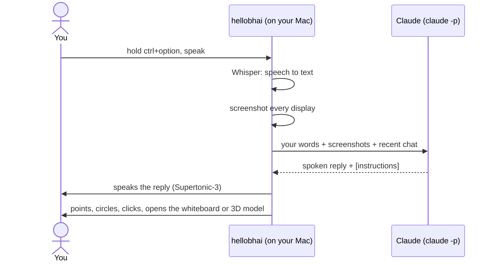

# How hellobhai works

## The big picture

hellobhai is a small Mac app that sits in your menu bar. It has three jobs: **listen** to you, ask **Claude** what to do, then **show and say** the answer on your screen. Everything except Claude's thinking happens on your Mac.

## What happens when you ask something

Say you're looking at a YouTube video of a gadget and you ask *"what is this device?"*

1. **You press ctrl+option.** A tiny keyboard listener notices the shortcut, even while another app is in front. The orb switches to its listening animation. (You can also type instead; see below.)
2. **You talk, then let go.** Your voice is recorded, and **Whisper** turns it into text right on your Mac. It works out by itself whether you spoke English, Hindi or Hinglish. If you circled something with the mouse while talking, that area is noted too.
3. **It takes a screenshot** of every display, so Claude can see exactly what you see.
4. **It asks Claude.** The text, the screenshots and your last few questions go to Claude through the `claude` command-line tool that comes with Claude Code. That uses your own login, so there are no API keys and no hellobhai server in between.
5. **Claude answers in two layers:** the words to say out loud, plus small instructions in square brackets for the app, like `[POINT:…]`, `[CIRCLE:…]`, `[SHOW:…]` or `[MODEL3D:…]`.
6. **The app speaks the words** with **Supertonic-3**, an on-device voice, one sentence at a time so it starts talking quickly. A small pill grows out of the notch while it speaks. The orb shows thinking until the first sentence plays, and speaking only while audio is actually playing.
7. **The app follows the instructions:**
   - `POINT`: a blue pointer flies out of the orb to a button or menu, then back in.
   - `CIRCLE`: gold, hand-drawn circles appear around the exact text it's talking about.
   - `CLICK` / `TYPE` / `KEY`: it clicks and types for you, then takes a fresh screenshot to check. It repeats this up to 8 times until the task is done. It only does this when you ask, and it asks before sending, posting or deleting anything.
   - `SHOW` / `NOTES`: a whiteboard or a notes page opens beside your cursor (see below).
   - `MODEL3D`: a 3D model is built right on top of the thing on your screen (see below).

### Typing instead of talking

Click the orb, or switch the hotkey to **Chat** mode in the menu bar panel, and a chat card slides in from the right or left screen edge. A typed message skips steps 1 and 2 and goes through the same screenshot, Claude and actions loop. The reply streams into the chat as Claude writes it (the bracket instructions are hidden), and it is read aloud only if you picked "Text + voice". Spoken questions always get a spoken reply, which also shows in the chat, so it reads as one conversation. Circling things while holding the hotkey stays a voice feature. Before Claude types or presses keys for you, the chat hands keyboard focus back to the app you were in, and while it clicks, the chat and the orb let clicks pass through to whatever is behind them (Claude's screenshots leave them out).

In Chat mode the hotkey opens or focuses the chat, and pressing it again tucks the chat into a small tab on the screen edge. In both modes the press also stops whatever bhai is doing.

## How the whiteboard and 3D models work

When Claude decides a picture would help, the app asks Claude a second, focused question: *"draw this, step by step"*. Claude streams back a script, one line at a time. Each line is either a sentence to say or a drawing command, like "draw a blue box called Battery" or "add a cylinder for the antenna".

- **Narration and drawing stay in step.** Each sentence is spoken while the shapes that belong to it are drawn. The blue pointer flies out of the orb and moves along every stroke as if it were holding the pen, with a soft pencil sound.
- **The whiteboard** is a small, locked-down web page inside the app. It draws hand-drawn shapes with **rough.js**, lays out diagrams automatically with **dagre** so nothing overlaps, and renders math with **KaTeX**.
- **3D models** use **three.js**. Claude describes the object in real millimeters as simple parts (boxes, cylinders, repeated pins, ready-made ports and connectors) with labels, reads the object's position and angle off the screenshot, and the app builds it part by part right over the thing on your screen. You can drag to rotate it.
- **Claude never writes code that runs.** It only sends simple instructions as data. The pages can't load anything from the internet.

## The pieces, and where they live in the code

| Piece | What it uses | File (in `macos/leanring-buddy/`) |
|-------|--------------|------|
| Menu bar app and settings panel | SwiftUI + AppKit | `leanring_buddyApp.swift`, `MenuBarPanelManager.swift`, `CompanionPanelView.swift` |
| The conductor that ties it all together | | `CompanionManager.swift` |
| Push-to-talk shortcut | `CGEvent` tap | `GlobalPushToTalkShortcutMonitor.swift` |
| Ears (speech to text) | WhisperKit (Whisper large-v3 turbo) on-device, Apple Speech as fallback | `BuddyDictationManager.swift`, `WhisperTranscriptionProvider.swift` |
| Eyes (screenshots) | ScreenCaptureKit | `CompanionScreenCaptureUtility.swift` |
| Brain | `claude -p` (Claude Code CLI) | `ClaudeCLI.swift` |
| Mouth (text to speech) | Supertonic-3 (voice F2) on-device, optional Kokoro-82M, macOS voice as last fallback | `LocalTTSClient.swift` |
| Hands (clicks, typing, Mac commands) | `CGEvent`, plus an allowlist: `osascript`, `open`, `mdfind`, `shortcuts`, `ls` | `ComputerControl.swift` |
| Blue pointer, gold circles, notch pill | Transparent full-screen overlay | `OverlayWindow.swift` |
| The orb (Rive animation, drag to move, click to chat) | Small always-on-top panel | `OrbWindow.swift`, `VisualToolkit/orb.html` |
| Typed chat (slides in from a screen edge, minimizes to a tab) | SwiftUI in a non-activating panel | `ChatPanel.swift` |
| Whiteboard and notes | WKWebView + rough.js, dagre, KaTeX, Prism | `VisualExplanationPanel.swift` |
| 3D models | WKWebView + three.js | `Model3DOverlay.swift`, `VisualToolkit/model3d.html` |

## What leaves your Mac

Only what goes to Claude: your words, the screenshots and recent chat, sent through your own Claude Code login. Listening, speaking, screenshots, drawing and 3D all run locally. There are no hellobhai servers, no analytics and no auto-updater. On first launch it downloads about 1GB of speech models from Hugging Face, once.
